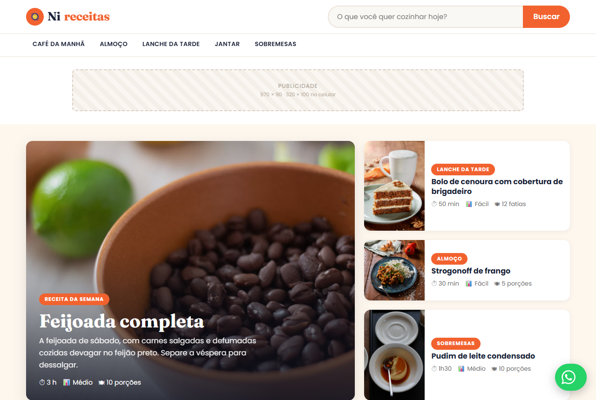

# Nireceitas

Site de receitas separado por refeição (café da manhã, almoço, lanche, jantar e sobremesas), feito do zero em um dia com HTML, CSS e JavaScript puros. Não tem framework, build nem servidor: abre direto no navegador.

**Ver no ar:** https://vicyone.github.io/nireceitas/



## O que tem

- **20 receitas** em 5 refeições, cada uma com tempo, porções, dificuldade, custo, ingredientes por grupo, utensílios, modo de preparo, dicas e perguntas frequentes.
- **Busca instantânea** por nome, resumo ou ingrediente, sem recarregar a página.
- **Página de receita gerada a partir dos dados** (`receita.html?id=feijoada`), com dados estruturados `Recipe` (schema.org) para o Google mostrar foto, tempo e passos na busca.
- **Contato por WhatsApp** com mensagem pronta e **espaços de anúncio** reservados, que se ligam e desligam numa linha só.
- Layout responsivo, pensado primeiro para o celular.

## Como foi construído

Antes de escrever, analisei como TudoGostoso, Panelinha, Receitas Nestlé e Allrecipes organizam a página de receita: o que vem antes da lista de ingredientes, onde ficam os anúncios e o que aparece no resultado do Google. O site foi construído com o Claude Code a partir dessa análise.

## Estrutura

| Arquivo | O que é |
|---|---|
| `index.html` | Página inicial: destaque, refeições e busca |
| `receita.html` | Página de uma receita, montada a partir do `id` na URL |
| `js/receitas.js` | Os dados: refeições e receitas |
| `js/app.js` | A montagem das páginas, a busca e o bloco de configuração `SITE` |
| `css/estilo.css` | O visual |

## Configurar

Tudo o que muda de um site para outro fica no objeto `SITE`, no topo de `js/app.js`: nome, slogan, número de WhatsApp, receita em destaque e se os anúncios aparecem.

## Rodar localmente

Abra o `index.html` no navegador. Para testar como se estivesse publicado:

```bash
npx serve .
```

Fotos do [Unsplash](https://unsplash.com) (licença livre).
